

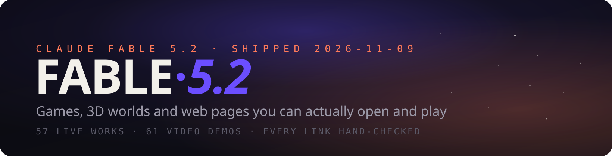

<h3>Things people built with Claude Fable 5.2 that you can actually open and play</h3>

**English** · [简体中文](README.zh-CN.md)

Claude Fable 5.2 shipped on 2026-11-09. Within two days X filled up with games, 3D worlds and web pages made with it. This list collects the ones **you can open right now**: 57 live works, every link opened and checked on 2026-11-10, plus 61 popular video-only demos in a separate section.
> 🍴 Forked from [fengyiqicoder/awesome-fable-5.2](https://github.com/fengyiqicoder/awesome-fable-5.2) — added the interactive gallery site, bilingual UI and search.
Every entry has a few-second GIF preview, credits its creator and links back to the original post for the full video. If this helps, a ⭐ keeps it coming — new works are still appearing daily.
> 🌐 **Prefer browsing over reading?** The full list is also available as an interactive gallery with search, bilingual UI and inline video playback: **[kingll2026.github.io/helium-fable-5.2](https://kingll2026.github.io/helium-fable-5.2/)**

## 📰 News
- **2026-11-11**: Interactive gallery site launched — search, EN/中文 toggle, video player ([source](index.html)).
- **2026-11-10**: Every entry now has a GIF preview.
- **2026-11-10**: First release — 57 live works + 61 video demos.

## 📑 Contents
- [⭐ Most Loved](#-most-loved)
- [🎮 Games](#-games) · 22
- [🌍 3D Worlds & Scenes](#-3d-worlds--scenes) · 12
- [🧰 Web Pages & Tools](#-web-pages--tools) · 15
- [🎬 Animation & Film (with source)](#-animation--film-with-source) · 8
- [📺 Video-only Demos](#-video-only-demos) · 61
- [🔗 Related Lists](#-related-lists)
- [🧭 How This List Was Made](#-how-this-list-was-made)
- [🤝 Contributing](#-contributing)

---

## ⭐ Most Loved
The six most-liked live works.

| # | Preview | Work | Creator | Post |
|---|---------|------|---------|------|
| 1 |  | **[Saltline — first-person shooter](https://claude.ai/artifact/BGY1SztrAYcJQHSsnHHGmp)** By an Anthropic engineer. One-shot prompts, no human feedback, 8 hours, ~$550. Models, sounds and textures all generated in code. ♥ 7.5k | [@felixrieseberg](https://x.com/felixrieseberg) | [post](https://x.com/felixrieseberg/status/2119925633564463609) |
| 23 |  | **[Claude App on a Blender laptop](https://claude.ai/artifact/QGWUAjRrzRzZWGcQzSMLfa)** One prompt built the whole room in Blender and rendered it in 4K. This is the web page shown on the laptop screen. ♥ 5.2k | [@rileybrown](https://x.com/rileybrown) | [post](https://x.com/rileybrown/status/2119902109709537708) |
| 8 |  | **[What the Water Keeps](https://what-the-water-keeps.vercel.app/)** A boat ride through 8 dreamlike worlds, playable in the browser. ♥ 3.7k | [@kevin_t_ngo](https://x.com/kevin_t_ngo) | [post](https://x.com/kevin_t_ngo/status/2119868968307695818) |
| 3 |  | **[Mirror Earth](https://www.spawn.co/@mattshumer/earth?room=local)** The whole planet as a destructible game world, with weather that matches the real Earth in real time. ♥ 2k | [@mattshumer_](https://x.com/mattshumer_) | [post](https://x.com/mattshumer_/status/2119877065701036047) |
| 50 | 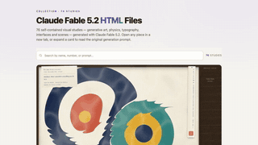 | **[76 single-file HTML pieces](https://miaai-lab.github.io/Claude-Fable-5.2-HTML-Files/)** Generative art, physics, type and UI, each with its original prompt. ♥ 2k | [@MiaAI_lab](https://x.com/MiaAI_lab) | [post](https://x.com/MiaAI_lab/status/2119930229661503893) |
| 6 | 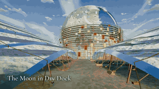 | **[Portals: Endless Worlds](https://portals-endless-worlds.netlify.app/)** 25,000 agents built 450+ code-only 3D worlds inspired by books, art and places, linked by portals you drift through. ♥ 1.5k ↳ [源码](https://github.com/emollick/ai-portals) ↳ [文章](https://www.oneusefulthing.org/p/fable-52-and-jagged-agi) | [@emollick](https://x.com/emollick) | [post](https://x.com/emollick/status/2119918307457577163) |

---

## 🎮 Games · 22
Games you can open and play right now, from first-person shooters to an entire destructible Earth.

| # | Preview | Work | Creator | Post |
|---|---------|------|---------|------|
| 1 |  | **[Saltline — first-person shooter](https://claude.ai/artifact/BGY1SztrAYcJQHSsnHHGmp)** By an Anthropic engineer. One-shot prompts, no human feedback, 8 hours, ~$550. Models, sounds and textures all generated in code. ♥ 7.5k | [@felixrieseberg](https://x.com/felixrieseberg) | [post](https://x.com/felixrieseberg/status/2119925633564463609) |
| 2 | 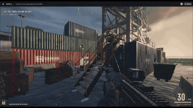 | **[Three Games (Saltline · The Clockmaker's Heart · Tidewright)](https://claude.ai/artifact/MXxb36zKgN261ckbGhmNin)** Signed by Felix Rieseberg: "All games made with Claude Fable 5.2. First drafts, no human feedback." The most-shared link of launch day. ♥ 730 ↳ [钟表匠之心](https://claude.ai/artifact/6MjtQjf4ee1ZZjEpafaEpa) ↳ [Tidewright](https://claude.ai/artifact/JTgyEMn7sn1q2riWrMb7D4) | [@felixrieseberg](https://x.com/felixrieseberg) | [post](https://x.com/vineerpasam/status/2119955306096857145) |
| 3 |  | **[Mirror Earth](https://www.spawn.co/@mattshumer/earth?room=local)** The whole planet as a destructible game world, with weather that matches the real Earth in real time. ♥ 2k | [@mattshumer_](https://x.com/mattshumer_) | [post](https://x.com/mattshumer_/status/2119877065701036047) |
| 4 | 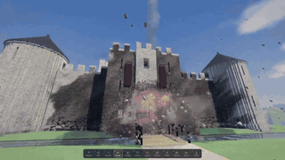 | **[Voxel Engine](https://www.spawn.co/@mattshumer/voxel-engine)** Built from a single prompt. Sound on. ♥ 668 | [@mattshumer_](https://x.com/mattshumer_) | [post](https://x.com/mattshumer_/status/2119870965106483384) |
| 5 |  | **[Hogwarts Royale](https://www.spawn.co/@mattshumer/hogwarts-royale)** "Create a mashup of Harry Potter and Fortnite" — a playable battle royale. ♥ 281 | [@mattshumer_](https://x.com/mattshumer_) | [post](https://x.com/mattshumer_/status/2119872098306810226) |
| 6 |  | **[Portals: Endless Worlds](https://portals-endless-worlds.netlify.app/)** 25,000 agents built 450+ code-only 3D worlds inspired by books, art and places, linked by portals you drift through. ♥ 1.5k ↳ [源码](https://github.com/emollick/ai-portals) ↳ [文章](https://www.oneusefulthing.org/p/fable-52-and-jagged-agi) | [@emollick](https://x.com/emollick) | [post](https://x.com/emollick/status/2119918307457577163) |
| 7 | 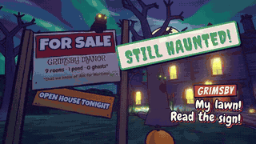 | **[I Would Have Gotten Away With It](https://i-would-have-gotten-away-with-it.netlify.app/)** A reverse Scooby-Doo: you are the villain scaring off meddling kids. Fable also made the trailer, music and sound. ♥ 450 | [@emollick](https://x.com/emollick) | [post](https://x.com/emollick/status/2119876449494540554) |
| 8 |  | **[What the Water Keeps](https://what-the-water-keeps.vercel.app/)** A boat ride through 8 dreamlike worlds, playable in the browser. ♥ 3.7k | [@kevin_t_ngo](https://x.com/kevin_t_ngo) | [post](https://x.com/kevin_t_ngo/status/2119868968307695818) |
| 9 |  | **[Turbo Tails](https://turbo-tails.vercel.app)** 3D kart racer: 6 racers, drifting, ramps, items, single and multiplayer. ♥ 112 ↳ [对比视频](https://youtu.be/SsSKJA0EHD4) | [@petergyang](https://x.com/petergyang) | [post](https://x.com/petergyang/status/2119901658394358005) |
| 10 | 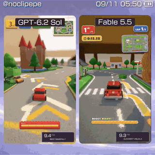 | **[Childhood Rug Racer](https://noclipepe.pages.dev/rug/)** A racing game on your childhood play rug, same prompt as GPT-6.2 Sol. The author calls the model "Fable 5.5 (routing)". ♥ 404 | [@noclipepe](https://x.com/noclipepe) | [post](https://x.com/noclipepe/status/2119728047754547326) |
| 11 |  | **[Rambo Dino](https://noclipepe.pages.dev/dino)** The Chrome T-Rex game, rebuilt. Compared against Opus 5.5, Gemini 4 Carbon and GPT-6 Astra. ♥ 97 | [@noclipepe](https://x.com/noclipepe) | [post](https://x.com/noclipepe/status/2119927838321328577) |
| 12 |  | **[Frontline Warfare Deathmatch](https://spawn.co/@robot/frontline-warfare-deathmatch)** A Call of Duty-style shooter in the browser. ♥ 86 | [@alightinastorm](https://x.com/alightinastorm) | [post](https://x.com/alightinastorm/status/2120020469487440210) |
| 13 |  | **[Feed the Backrooms](https://feed-backrooms.vercel.app)** The Backrooms, reversed: you are the monster and your job is to catch people. ♥ 80 | [@LexnLin](https://x.com/LexnLin) | [post](https://x.com/LexnLin/status/2119966127149429093) |
| 14 |  | **[Cloud Stunt 3D](https://finderchangchang.github.io/cloud-stunt-3d/)** Generated in 30 minutes; an optimized "golden" version is linked too. ♥ 171 ↳ [优化版](https://finderchangchang.github.io/cloud-stunt-3d/golden/) | [@jev_chat](https://x.com/jev_chat) | [post](https://x.com/jev_chat/status/2120015641151426838) |
| 15 | 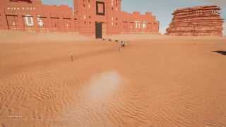 | **[Worm Rider](https://github.com/amirmushichge/worm-rider)** Open source. 220 KB, 3,400 lines, 10 prompts, every model built from scratch in Claude Code. ♥ 170 | [@AmirMushich](https://x.com/AmirMushich) | [post](https://x.com/AmirMushich/status/2119937977426338283) |
| 16 | 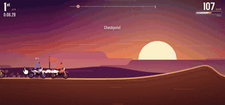 | **[Roost](https://claude.ai/artifact/DLnFodkTwvawCNwurDmSZK?sk=5N6PtC07f1niB7h3I6clZQ)** 3D dirt-bike racing in one chat: 5 prompts, 15 minutes, 3 tracks, AI rivals, nitro, handlebar cam. ♥ 2 | [@tejas3732](https://x.com/tejas3732) | [post](https://x.com/tejas3732/status/2120091513657139549) |
| 17 | 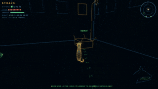 | **[Stray Cat](https://claude.ai/artifact/4nPXUKJjQWNsZEHVNmXXCt)** Rescue kittens, hiss at dogs, yowl at an old tomcat. Every sound is synthesized. ♥ 13 | [@aimikoda](https://x.com/aimikoda) | [post](https://x.com/aimikoda/status/2120120133712593118) |
| 18 |  | **[Tilt Labyrinth](https://blog.silencestar.com/posts/tilt-labyrinth/play/)** A wooden ball maze in 2,000 lines of three.js. Fable profiled it from 55 ms to 9 ms per frame on its own. ♥ 15 | [@mylifcc](https://x.com/mylifcc) | [post](https://x.com/mylifcc/status/2120054646282870910) |
| 19 | 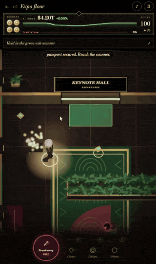 | **[Silicon Seduction](https://silicon-seduction.vercel.app/)** Can you make it out without being seduced? ♥ 12 | [@ZryMiller](https://x.com/ZryMiller) | [post](https://x.com/ZryMiller/status/2119918766691954691) |
| 20 | 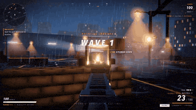 | **[Vippi](https://vippi.vercel.app/)** A COD-style shooter. The author's creepy-game benchmark is linked too. ♥ 1 ↳ [恐怖游戏测试](https://claude.ai/artifact/HSxhHE91J2jhLsB8WiTgUc) | [@Shrit1401](https://x.com/Shrit1401) | [post](https://x.com/Shrit1401/status/2120060593763926314) |
| 21 |  | **[Four-character fighting game](https://claude.ai/artifact/1QGGhB68jMCjjjeeKtKNUo)** Fable 5.2 + ElevenLabs MCP for 39 voice and sound clips, including an announcer it designed. Desktop + keyboard. ♥ 2 | [@promodenstudio](https://x.com/promodenstudio) | [post](https://x.com/promodenstudio/status/2120085977079107788) |
| 22 |  | **[VOWLORN](https://higgsfield.ai/@higgsfield.studio/blogs/fable-5-2-built-this-rpg-from-pure-code-here-s-every-step)** A dark RPG where even the voices are code, deployed through Higgsfield MCP. Links go to the play pages with full workflows. ♥ 24 ↳ [骑龙游戏](https://higgsfield.ai/@higgsfield.studio/blogs/claude-fable-5-2-built-a-dragon-riding-game-play-it-free) ↳ [手绘变恐怖游戏](https://higgsfield.ai/@higgsfield.studio/blogs/one-drawing-fable-5-2-turned-it-into-a-horror-game) | [@higgsfield_ai](https://x.com/higgsfield_ai) | [post](https://x.com/higgsfield_ai/status/2119997122896601269) |

---

## 🌍 3D Worlds & Scenes · 12
Explorable 3D worlds and real-time rendered scenes.

| # | Preview | Work | Creator | Post |
|---|---------|------|---------|------|
| 23 |  | **[Claude App on a Blender laptop](https://claude.ai/artifact/QGWUAjRrzRzZWGcQzSMLfa)** One prompt built the whole room in Blender and rendered it in 4K. This is the web page shown on the laptop screen. ♥ 5.2k | [@rileybrown](https://x.com/rileybrown) | [post](https://x.com/rileybrown/status/2119902109709537708) |
| 24 | 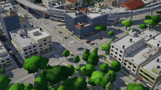 | **[1 km² of Indiranagar](https://indiranagar-live.vercel.app)** A live 3D slice of Bengaluru from map data and one prompt. ♥ 405 | [@anshu4321](https://x.com/anshu4321) | [post](https://x.com/anshu4321/status/2119938067758772403) |
| 25 |  | **[Pirate Ship](https://tests.jazii.dev/)** One shot, ~1.5 hours, ~35M tokens (~$34). ♥ 107 | [@notjazii](https://x.com/notjazii) | [post](https://x.com/notjazii/status/2119905661505122575) |
| 26 | 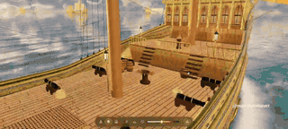 | **[3D Sailing Ship](https://claude.ai/artifact/7ge282etTXSS4edGFTFa85)** Pure Three.js, no Blender or external assets. ~38 minutes, ~$17. ♥ 100 | [@marcthecreatorr](https://x.com/marcthecreatorr) | [post](https://x.com/marcthecreatorr/status/2119890973560054072) |
| 27 | 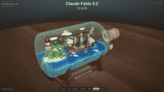 | **[Voxel World in a Bottle](https://claude.ai/artifact/9EgZpErM17kH2a9Q3WXW6f)** 30 minutes, $12.81. ♥ 55 | [@vib3coded](https://x.com/vib3coded) | [post](https://x.com/vib3coded/status/2120104517282775514) |
| 28 |  | **[Orca Jelly](https://claude.ai/artifact/2PBXuQAnWDS2NpiPXHNLfL)** A soft-body gummy orca material study. Opus 5.5's version is linked for comparison. ♥ 102 ↳ [Opus 5.5 版](https://claude.ai/artifact/75KLotWzZQ5RR23BGLePb8) | [@vib3coded](https://x.com/vib3coded) | [post](https://x.com/vib3coded/status/2119951060752375827) |
| 29 | 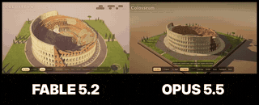 | **[Voxel Colosseum](https://claude.ai/artifact/7nmzhxeamcunJbKVK32ptz)** Walk around the ruined inner ring. Opus 5.5's diorama version is linked for comparison. ♥ 19 ↳ [Opus 5.5 版](https://claude.ai/artifact/B7ZmVS7Yr3BUc99ZyGk2bX) | [@aGim_asf](https://x.com/aGim_asf) | [post](https://x.com/aGim_asf/status/2119918363799376270) |
| 30 | 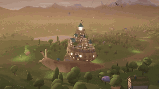 | **[A Hamlet on a Giant Snail](https://claude.ai/artifact/BCDCNHRTq3y9W4Px3xc4DN)** "Bring a 3D castle to life in an HTML file." Hand-written WebGL2, no libraries, ~5,500 trees, day/night cycle. | [@L34342Lin](https://x.com/L34342Lin) | [post](https://x.com/L34342Lin/status/2120030246108066195) |
| 31 |  | **[Wooden Pagoda Transformation](https://claude.ai/artifact/UqU4w7jSr6pzF2McsbyQjJ)** 3,357 parts assemble a five-storey pagoda that turns into a swordswoman. Music computed in code. | [@acupofai](https://x.com/acupofai) | [post](https://x.com/acupofai/status/2120119243043995748) |
| 32 |  | **[Vancouver From Above](https://vancouver.webly.site)** The city rebuilt in three.js. ♥ 39 | [@tokifyi](https://x.com/tokifyi) | [post](https://x.com/tokifyi/status/2120020272153764172) |
| 33 | 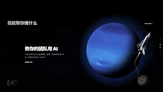 | **[One-way Trip to a Black Hole](https://zondark.com)** A personal site rebuilt as a scroll journey from Earth to a black hole. ♥ 4 | [@ZondarkAI](https://x.com/ZondarkAI) | [post](https://x.com/ZondarkAI/status/2120106341423571097) |
| 34 | 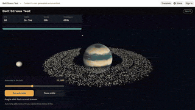 | **[Belt Stress Test](https://claude.ai/artifact/FETrKoitcqxPQjbQvZd79C)** ~20,000 orbiting asteroids; it keeps adding rocks until your device drops below 30 fps. ♥ 4 | [@fadihares95](https://x.com/fadihares95) | [post](https://x.com/fadihares95/status/2119885634814857500) |

---

## 🧰 Web Pages & Tools · 15
Useful or stunning web apps and tools.

| # | Preview | Work | Creator | Post |
|---|---------|------|---------|------|
| 36 |  | **[Typed](https://typed.page/)** A fully working typewriter: type or click keys, writing timers, whiteout, autocorrect. ♥ 167 | [@clairevo](https://x.com/clairevo) | [post](https://x.com/clairevo/status/2119905651359142132) |
| 37 | 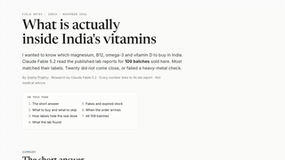 | **[Which Vitamins to Buy in India](https://itspsneha.com/supplements)** Built after reading lab reports for 109 tested batches. ♥ 433 | [@itspsneha](https://x.com/itspsneha) | [post](https://x.com/itspsneha/status/2120048494761451974) |
| 38 |  | **[Claudia Gallery](https://claudia.gallery)** "Make the video of your dreams" — two shots, 9 hours. ♥ 1.1k | [@anabology](https://x.com/anabology) | [post](https://x.com/anabology/status/2120010995309457643) |
| 39 |  | **[The History of Writing](https://v2.video/riley/the-history-of-writing/v1)** An interactive film from one prompt; prompt and files shared. ♥ 532 | [@rileybrown](https://x.com/rileybrown) | [post](https://x.com/rileybrown/status/2119946022767980985) |
| 40 | 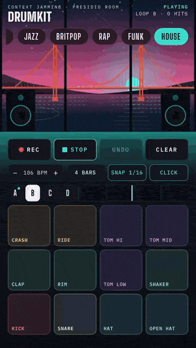 | **[Bay Drum Kit](https://claude.ai/artifact/9yQkezie4jY3oz2YDLFDiq)** Every hit reverberates across the bay. ♥ 4 | [@BretKerr](https://x.com/BretKerr) | [post](https://x.com/BretKerr/status/2119995870854988177) |
| 41 |  | **[Dub Techno Track + Visualizer](https://claude.ai/artifact/Pk6rHPyRwfShT37kiU1sT6)** One shot. ♥ 4 | [@bartdecrem](https://x.com/bartdecrem) | [post](https://x.com/bartdecrem/status/2119926997422133417) |
| 42 | 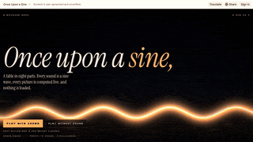 | **[Demoscene Demo](https://claude.ai/artifact/4aEy6FtUi7jrm9U7uYgp8K)** "Make a demo in the demoscene tradition that runs in the browser." ♥ 1 | [@ndril](https://x.com/ndril) | [post](https://x.com/ndril/status/2119899340642894235) |
| 43 | 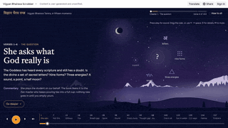 | **[112 Forms of Meditation](https://claude.ai/artifact/H8E7AonW2KFrzdRimaLeXb)** Visualized for techies. | [@RishabJ108](https://x.com/RishabJ108) | [post](https://x.com/RishabJ108/status/2120042407484084558) |
| 44 |  | **[Ramayana Family Tree](https://claude.ai/artifact/5ufHvxgvXTf5YgQeTR8TbG)** The lead actor's ties by blood and marriage to 65 Bollywood stars. ♥ 2 | [@chhavsz](https://x.com/chhavsz) | [post](https://x.com/chhavsz/status/2119942973958078785) |
| 45 |  | **[House Design Proposal](https://claude.ai/artifact/TiymxxFXzMo7xhWUaecbzk)** A detached-house design proposal (Korean), made in a day. ♥ 3 | [@pnumech](https://x.com/pnumech) | [post](https://x.com/pnumech/status/2120117665041940807) |
| 46 |  | **[20 Landing Page Redesigns](https://jwt-designs-preview.noone-697.workers.dev/)** 20 alternatives to a JWT plugin's landing page from one simple prompt. ♥ 7 | [@Tmeister](https://x.com/Tmeister) | [post](https://x.com/Tmeister/status/2119983842841018482) |
| 47 |  | **[Driftwood (Fable vs Opus)](https://www.asumacodes.xyz/arena/driftwood)** Same prompt, one shot each, both pages live. Also: a Pomodoro focus room and a bug hunt. ♥ 7 ↳ [番茄钟专注室](https://www.asumacodes.xyz/arena/focus-room) ↳ [找 Bug 对比](https://www.asumacodes.xyz/arena/bug-hunt) ↳ [系列首页](https://www.asumacodes.xyz/arena) | [@AsumaCodes](https://x.com/AsumaCodes) | [post](https://x.com/AsumaCodes/status/2120130668848177432) |
| 48 |  | **[Ribbon Hero](https://motionsites.ai/?prompt=vante-ribbon-hero)** A hero section made with Fable 5.2 + GPT Image 2.6. ♥ 65 | [@viktoroddy](https://x.com/viktoroddy) | [post](https://x.com/viktoroddy/status/2119985044542705916) |
| 49 |  | **[nikechan.com redesign](https://nikechan.com/)** A personal site redesigned end to end. ♥ 58 | [@tegnike](https://x.com/tegnike) | [post](https://x.com/tegnike/status/2120110145841578173) |
| 50 |  | **[76 single-file HTML pieces](https://miaai-lab.github.io/Claude-Fable-5.2-HTML-Files/)** Generative art, physics, type and UI, each with its original prompt. ♥ 2k | [@MiaAI_lab](https://x.com/MiaAI_lab) | [post](https://x.com/MiaAI_lab/status/2119930229661503893) |

---

## 🎬 Animation & Film (with source) · 8
Animation and film projects with full source included.

| # | Preview | Work | Creator | Post |
|---|---------|------|---------|------|
| 51 |  | **[One Sweep](https://github.com/anstapnever/one-sweep)** A 78-second anime fight in pure Three.js, six agent teams in parallel. Author says "Fable 5.5". ♥ 238 | [@anstapnever](https://x.com/anstapnever) | [post](https://x.com/anstapnever/status/2119772039037014524) |
| 52 |  | **[Blackout](https://github.com/anstapnever/blackout)** A 79-second anime short, all code. ♥ 96 | [@anstapnever](https://x.com/anstapnever) | [post](https://x.com/anstapnever/status/2119915123070644263) |
| 53 | 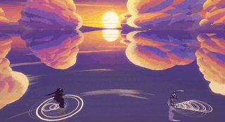 | **[Kagami](https://github.com/Florencvv/kagami)** 84 seconds of anime where every frame is code. Author says "Fable 5.5". ♥ 36 | [@flxrnc](https://x.com/flxrnc) | [post](https://x.com/flxrnc/status/2119767052021903831) |
| 54 |  | **[Ryu](https://github.com/seeconever/ryu)** A mountain wakes up as a dragon. No image or video models. Author says "Fable 5.5". ♥ 36 | [@seeconvm](https://x.com/seeconvm) | [post](https://x.com/seeconvm/status/2119777169542938662) |
| 55 |  | **[Godzilla Nights](https://github.com/ChetasLua/godzilla-nights)** Images drawn in pure code, lightly animated. ♥ 159 | [@chetaslua](https://x.com/chetaslua) | [post](https://x.com/chetaslua/status/2119981510199808368) |
| 56 |  | **[Ballpoint](https://github.com/crossps/ballpoint)** Macro ASMR of a ballpoint pen, open-sourced to prove it is code, not a video model. ♥ 239 | [@camperaigg](https://x.com/camperaigg) | [post](https://x.com/camperaigg/status/2119777467074580741) |
| 57 |  | **[Robot Hand on a Spiral Staircase](https://github.com/skild-ai/steel-webgpu/pull/7)** Fable 5.2 + the Steel physics engine: a hand walking on its fingers. ♥ 52 | [@Luckyballa](https://x.com/Luckyballa) | [post](https://x.com/Luckyballa/status/2119915557663506720) |
| 58 |  | **[Kumiko Launch Film](https://usekumiko.app/)** Given only the music and the website, one shot. The plugin used is linked. ♥ 15 ↳ [插件](https://github.com/atuljha23/claude-motion-skill) | [@sudoaptaj](https://x.com/sudoaptaj) | [post](https://x.com/sudoaptaj/status/2119937909373460990) |

---

## 📺 Video-only Demos · 61
Creators posted a video but no public link. Click a preview to watch the original post.

| # | Preview | Work | Creator | Post |
|---|---------|------|---------|------|
| 61 | 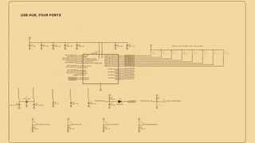 | ****Anthropic: pre-release projects**** What Fable 5.2 and Mythos 5.2 built across fields during testing. ♥ 30.8k | [@claudeai](https://x.com/claudeai) | [post](https://x.com/claudeai/status/2119899459761131615) |
| 62 | 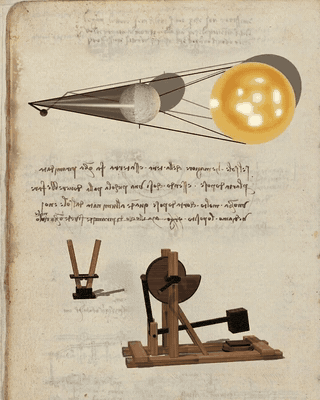 | ****Da Vinci's notebooks, interactive**** A 500-year-old notebook PDF turned into inventions you can play with. ♥ 1.8k | [@alexalbert__](https://x.com/alexalbert__) | [post](https://x.com/alexalbert__/status/2119916954337349737) |
| 63 |  | ****Fishslop run**** 76 minutes, ~$42. ♥ 2k | [@theo](https://x.com/theo) | [post](https://x.com/theo/status/2119926277801144695) |
| 64 | 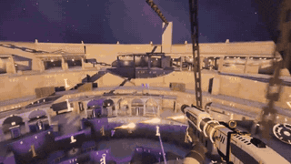 | ****Arena FPS with portals**** Playtested in the office. ♥ 1.6k | [@_sholtodouglas](https://x.com/_sholtodouglas) | [post](https://x.com/_sholtodouglas/status/2119935331499925557) |
| 65 |  | ****Fast-camera 3D scene**** 30 minutes with a few Opus 5.5 subagents. ♥ 1.5k | [@LexnLin](https://x.com/LexnLin) | [post](https://x.com/LexnLin/status/2119880654858977333) |
| 66 | 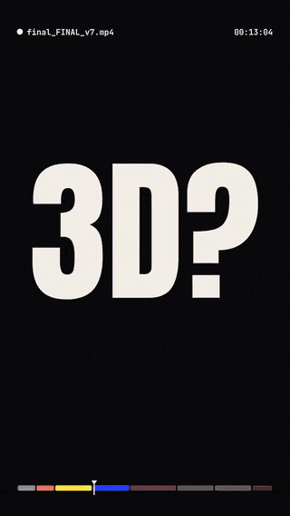 | ****A message to video editors**** ♥ 1.4k | [@ChrisGPT](https://x.com/ChrisGPT) | [post](https://x.com/ChrisGPT/status/2119998815856218494) |
| 67 | 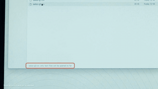 | ****An operating system from an empty folder**** Anthropic's demo of 1,000+ coordinated agents. ♥ 1.1k | [@chetaslua](https://x.com/chetaslua) | [post](https://x.com/chetaslua/status/2119870650722763052) |
| 68 | 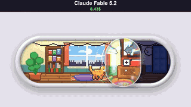 | ****Addictive volume slider**** 10 minutes, $8.43. ♥ 1k | [@vib3coded](https://x.com/vib3coded) | [post](https://x.com/vib3coded/status/2119876781700505627) |
| 69 | 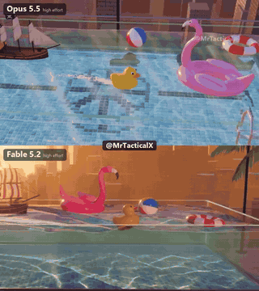 | ****Glass Pool (Fable vs Opus)**** ♥ 812 | [@MrTacticalX](https://x.com/MrTacticalX) | [post](https://x.com/MrTacticalX/status/2119955647542542439) |
| 70 |  | ****One-prompt GTA 6**** ♥ 709 | [@ericmaskfr](https://x.com/ericmaskfr) | [post](https://x.com/ericmaskfr/status/2119910195325481026) |
| 71 | 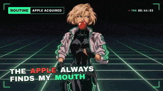 | ****One-shot reel**** ♥ 573 | [@WesRoth](https://x.com/WesRoth) | [post](https://x.com/WesRoth/status/2119953913160093817) |
| 72 | 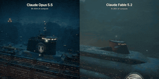 | ****Opus 5.5 vs Fable 5.2**** ♥ 464 | [@dom_scholz](https://x.com/dom_scholz) | [post](https://x.com/dom_scholz/status/2119933150025363661) |
| 73 |  | ****A whole movie in code**** Voices, graphics, everything. ♥ 400 | [@mattshumer_](https://x.com/mattshumer_) | [post](https://x.com/mattshumer_/status/2119900920347828670) |
| 74 | 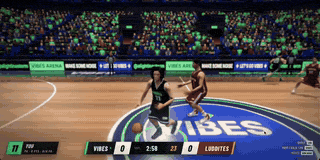 | ****AAA three.js basketball**** ♥ 355 | [@alightinastorm](https://x.com/alightinastorm) | [post](https://x.com/alightinastorm/status/2120010936584945922) |
| 75 | 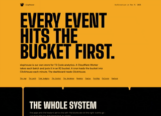 | ****A data-pipeline write-up that became a design**** ♥ 327 | [@theo](https://x.com/theo) | [post](https://x.com/theo/status/2120104895646937409) |
| 76 | 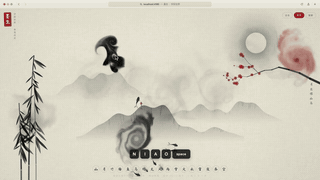 | ****Ink letters**** Type a character and it becomes live fluid ink, with sound. ♥ 298 | [@op7418](https://x.com/op7418) | [post](https://x.com/op7418/status/2120085300185833878) |
| 77 | 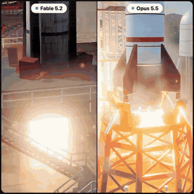 | ****Rocket launch (Fable vs Opus)**** ♥ 295 | [@Bhavani_00007](https://x.com/Bhavani_00007) | [post](https://x.com/Bhavani_00007/status/2119902204320780676) |
| 78 |  | ****A video edited by Fable about editing with Fable**** ♥ 294 | [@rileybrown](https://x.com/rileybrown) | [post](https://x.com/rileybrown/status/2119973951027724385) |
| 79 | 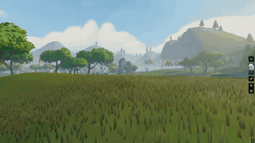 | ****A stylized MMO world in a day**** ♥ 275 | [@Izkimar](https://x.com/Izkimar) | [post](https://x.com/Izkimar/status/2119931740940640542) |
| 80 |  | ****Tropical-island FPS**** One prompt. ♥ 273 | [@imantiai](https://x.com/imantiai) | [post](https://x.com/imantiai/status/2119979537320534135) |
| 81 |  | ****App redesign, 5.1 vs 5.2**** ♥ 242 | [@RuslanKyrch](https://x.com/RuslanKyrch) | [post](https://x.com/RuslanKyrch/status/2119896220814762218) |
| 82 |  | ****Same prompt, Fable vs Opus**** ♥ 200 | [@notjazii](https://x.com/notjazii) | [post](https://x.com/notjazii/status/2119886035421442097) |
| 83 |  | ****Chalk art comes alive**** ♥ 199 | [@dfeinition](https://x.com/dfeinition) | [post](https://x.com/dfeinition/status/2119881243990859818) |
| 85 |  | ****Fabric and light**** ♥ 186 | [@dfeinition](https://x.com/dfeinition) | [post](https://x.com/dfeinition/status/2119886262211625062) |
| 86 |  | ****Blender + Reaper sound design**** ♥ 182 | [@AmirMushich](https://x.com/AmirMushich) | [post](https://x.com/AmirMushich/status/2119903338078564844) |
| 87 | 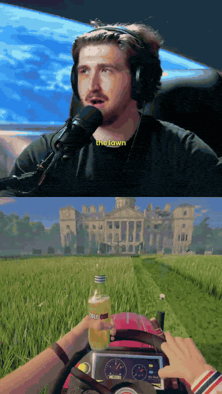 | ****Lawn-mowing simulator**** ♥ 178 | [@_MaxBlade](https://x.com/_MaxBlade) | [post](https://x.com/_MaxBlade/status/2119992020076814436) |
| 88 | 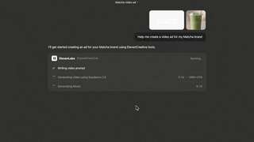 | ****An ad with the ElevenLabs MCP**** ♥ 177 | [@ElevenCreative](https://x.com/ElevenCreative) | [post](https://x.com/ElevenCreative/status/2120025947709837525) |
| 89 |  | ****Blender castle (Fable vs Opus)**** ♥ 174 | [@Stefan_3D_AI](https://x.com/Stefan_3D_AI) | [post](https://x.com/Stefan_3D_AI/status/2120041169719894165) |
| 90 | 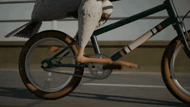 | ****Pelican riding a bicycle in Blender**** ~4,800 lines of Python, 444 frames. ♥ 171 | [@themianoo](https://x.com/themianoo) | [post](https://x.com/themianoo/status/2120042064666882266) |
| 91 |  | ****Sword-fighting game**** ♥ 171 | [@EvanMilenko](https://x.com/EvanMilenko) | [post](https://x.com/EvanMilenko/status/2119969113762082931) |
| 92 | 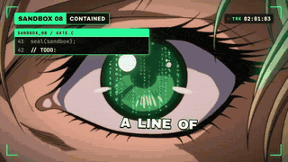 | ****Music video**** ♥ 162 | [@WesRoth](https://x.com/WesRoth) | [post](https://x.com/WesRoth/status/2119911161386934330) |
| 93 |  | ****4 hours in Unreal Engine 5.9 via MCP**** ♥ 142 | [@_MaxBlade](https://x.com/_MaxBlade) | [post](https://x.com/_MaxBlade/status/2120109725740159390) |
| 94 | 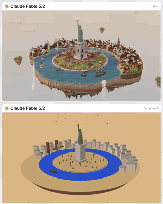 | ****1886 New York floating in the sky**** ♥ 137 | [@semichenkko](https://x.com/semichenkko) | [post](https://x.com/semichenkko/status/2119960596951236675) |
| 95 | 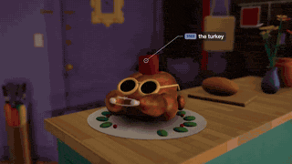 | ****Monica's apartment in three.js**** ♥ 135 | [@chetaslua](https://x.com/chetaslua) | [post](https://x.com/chetaslua/status/2120111159726727321) |
| 96 | 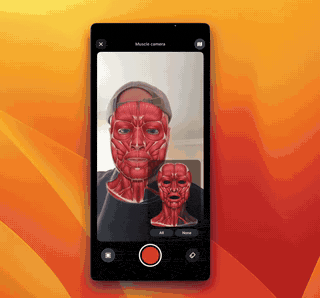 | ****SwiftUI eye-color app**** ♥ 134 | [@solotechdev](https://x.com/solotechdev) | [post](https://x.com/solotechdev/status/2120071690482794603) |
| 97 | 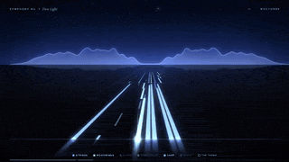 | ****A symphony**** ♥ 130 | [@RJasonHA](https://x.com/RJasonHA) | [post](https://x.com/RJasonHA/status/2120007540713099768) |
| 98 |  | ****A robot you could build at home**** ♥ 128 | [@mattshumer_](https://x.com/mattshumer_) | [post](https://x.com/mattshumer_/status/2119889518564147409) |
| 99 | 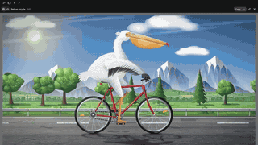 | ****Pelican on a bicycle (classic test)**** ♥ 122 | [@abhinavflac](https://x.com/abhinavflac) | [post](https://x.com/abhinavflac/status/2119884257145581980) |
| 100 | 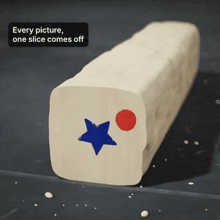 | ****Claymation**** ♥ 116 | [@dfeinition](https://x.com/dfeinition) | [post](https://x.com/dfeinition/status/2119892208937517201) |
| 102 |  | ****Four game-machine concepts**** VFX, mechanics and physics tests. ♥ 114 | [@techartist_](https://x.com/techartist_) | [post](https://x.com/techartist_/status/2119946891106394518) |
| 103 | 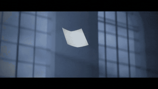 | ****A library at midnight**** 24,000 pages take flight. ♥ 105 | [@lemomo_ai](https://x.com/lemomo_ai) | [post](https://x.com/lemomo_ai/status/2120118194409193682) |
| 104 |  | ****A Bach-style fugue**** Written in LilyPond. ♥ 90 | [@aug5thmusic](https://x.com/aug5thmusic) | [post](https://x.com/aug5thmusic/status/2119907891419480107) |
| 105 | 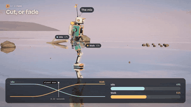 | ****Motion blending, explained by a robot**** ♥ 86 | [@dfeinition](https://x.com/dfeinition) | [post](https://x.com/dfeinition/status/2119870838606381391) |
| 106 |  | ****Recreating a Bora Bora photo**** ♥ 79 | [@AlchainHust](https://x.com/AlchainHust) | [post](https://x.com/AlchainHust/status/2120065556003102731) |
| 107 |  | ****Rubik's cube robot (Fable vs Opus)**** ♥ 78 | [@charliejhills](https://x.com/charliejhills) | [post](https://x.com/charliejhills/status/2120105823737397644) |
| 108 |  | ****A studio rebuilt from photos**** ♥ 68 | [@rpnickson](https://x.com/rpnickson) | [post](https://x.com/rpnickson/status/2119969928304357507) |
| 109 |  | ****A launch film from one sentence**** ♥ 68 | [@wangray](https://x.com/wangray) | [post](https://x.com/wangray/status/2120040640423850168) |
| 110 |  | ****Kids' English cartoon**** ♥ 63 | [@linxiaobei888](https://x.com/linxiaobei888) | [post](https://x.com/linxiaobei888/status/2119978892861829227) |
| 111 |  | ****Sea serpent in Blender**** ♥ 59 | [@Stefan_3D_AI](https://x.com/Stefan_3D_AI) | [post](https://x.com/Stefan_3D_AI/status/2120039417981333599) |
| 112 |  | ****Four models, one text effect**** ♥ 55 | [@leppppp1](https://x.com/leppppp1) | [post](https://x.com/leppppp1/status/2119960122713899015) |
| 113 |  | ****Virus capsid from 420 subunits**** One prompt, one HTML file. ♥ 52 | [@TekonBurns](https://x.com/TekonBurns) | [post](https://x.com/TekonBurns/status/2119871565311660260) |
| 114 |  | ****Game with and without ElevenLabs audio**** ♥ 47 | [@ElevenCreative](https://x.com/ElevenCreative) | [post](https://x.com/ElevenCreative/status/2119963230403776554) |
| 115 |  | ****Sound-on piece**** ♥ 42 | [@guanmo_ai](https://x.com/guanmo_ai) | [post](https://x.com/guanmo_ai/status/2119989925038985382) |
| 116 |  | ****Lion from a carpet (Fable vs Gemini)**** ♥ 42 | [@kinderlayer](https://x.com/kinderlayer) | [post](https://x.com/kinderlayer/status/2120112222227648957) |
| 117 |  | ****A $36 Game of Thrones dragon**** ♥ 42 | [@Lummox_eth](https://x.com/Lummox_eth) | [post](https://x.com/Lummox_eth/status/2120093679243194793) |
| 118 |  | ****A mobile game running as an Artifact**** ♥ 40 | [@ChrisGPT](https://x.com/ChrisGPT) | [post](https://x.com/ChrisGPT/status/2119989626568126509) |
| 119 |  | ****A day-one film (prompt PDF shared)**** ♥ 40 | [@flxrnc](https://x.com/flxrnc) | [post](https://x.com/flxrnc/status/2119961301791174720) |
| 120 |  | ****Tesla Roadster kickflip in Blender**** ♥ 38 | [@Stefan_3D_AI](https://x.com/Stefan_3D_AI) | [post](https://x.com/Stefan_3D_AI/status/2120101582444597446) |
| 121 |  | ****Paris on a floating island**** ♥ 32 | [@ItsmeAjayKV](https://x.com/ItsmeAjayKV) | [post](https://x.com/ItsmeAjayKV/status/2119896772713849174) |
| 122 |  | ****Snow Globe (Fable vs Opus)**** ♥ 30 | [@MrTacticalX](https://x.com/MrTacticalX) | [post](https://x.com/MrTacticalX/status/2119949557664735583) |
| 123 |  | ****Chinatown in code**** ♥ 35 | [@RJasonHA](https://x.com/RJasonHA) | [post](https://x.com/RJasonHA/status/2120075740222005569) |

---

## 🔗 Related Lists
- [awesome-fable5-2-videos](https://github.com/yihui-dev/awesome-fable5-2-videos) — A sister list focused on videos and the prompts behind them.

## 🧭 How This List Was Made
- All 118 works were collected from X posts in the 48 hours after the 2026-11-09 release.
- Every work link was opened in a browser and confirmed to load; every video was watched or spot-checked.
- GIF previews (a few seconds each, muted, low-res) are recorded from the creator's own demo video or the live site.
- Press coverage, "now available on X" ads, tool repos and reshares were removed. Credit goes to the original creator; a resharer is noted only when the creator posted no link.

## 🤝 Contributing
Found one we missed? Open an [issue](../../issues/new) or a PR with the work link and the original post. The link must open directly and the work must be made with Fable 5.2. See [CONTRIBUTING.md](CONTRIBUTING.md).

Entries are added to [`data/works.json`](data/works.json) and both READMEs are regenerated from it.

## ⚖️ License & Disclaimer
All works belong to their creators. This repository only indexes them, keeping short low-res GIF previews and no full works or videos; watch the full video on the original post. Creators can ask for a preview or entry to be removed via an issue. Not affiliated with Anthropic.

Content in this repository is released under [CC0-1.0](LICENSE).

Curated by <strong>Helium</strong> · Forked from <a href="https://github.com/fengyiqicoder/awesome-fable-5.2">awesome-fable-5.2</a>

