

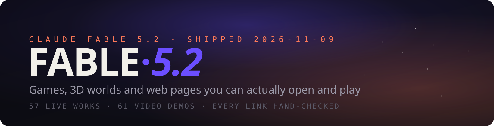

<h3>用 Claude Fable 5.2 做出的、真正可以打开来玩的东西</h3>

**简体中文** · [English](README.md)

Claude Fable 5.2 在 2026-11-09 发布。发布后两天里，X 上出现了大量用它做的游戏、3D 世界和网页。这份清单只收**能点开就用的作品**：57 个在线作品，每个链接都在 2026-11-10 实际打开验证过；另有 61 个只发了视频的高赞演示，单独放在后面。
> 🍴 Fork 自 [fengyiqicoder/awesome-fable-5.2](https://github.com/fengyiqicoder/awesome-fable-5.2) — 本仓库在此基础上新增了交互式画廊站点、双语界面和搜索功能。
每一项都配了几秒的动图预览，写明作者，并链接回原帖看完整视频。觉得有用就点个 ⭐，作品还在每天增加。
> 🌐 **不想啃表格？** 完整清单已同步为可交互画廊：支持搜索、中英切换、视频站内播放：**[kingll2026.github.io/helium-fable-5.2](https://kingll2026.github.io/helium-fable-5.2/)**

## 📰 动态
- **2026-11-11**: 交互画廊上线 — 搜索、中英切换、视频播放（[源码](index.html)）。
- **2026-11-10**: 每条作品都配上了动图预览。
- **2026-11-10**: 首次发布 — 57 个在线作品 + 61 个视频演示。

## 📑 目录
- [⭐ 最受欢迎](#-最受欢迎)
- [🎮 游戏](#-游戏) · 22
- [🌍 3D 世界 & 场景](#-3d-世界--场景) · 12
- [🧰 网页 & 工具](#-网页--工具) · 15
- [🎬 动画 & 短片（附源码）](#-动画--短片附源码) · 8
- [📺 仅视频演示](#-仅视频演示) · 61
- [🔗 相关清单](#-相关清单)
- [🧭 这份清单是怎么做的](#-这份清单是怎么做的)
- [🤝 投稿](#-投稿)

---

## ⭐ 最受欢迎
点赞数最高的六个在线作品。

| # | Preview | Work | Creator | Post |
|---|---------|------|---------|------|
| 1 |  | **[Saltline 第一人称射击](https://claude.ai/artifact/BGY1SztrAYcJQHSsnHHGmp)** Anthropic 工程师；一次性提示、无人工反馈跑 8 小时，约 $550；模型、音效、贴图全部代码生成 ♥ 7.5k | [@felixrieseberg](https://x.com/felixrieseberg) | [post](https://x.com/felixrieseberg/status/2119925633564463609) |
| 23 |  | **[Blender 房间里的「Claude App」网页](https://claude.ai/artifact/QGWUAjRrzRzZWGcQzSMLfa)** 一条提示词建整个房间并渲 4K；链接是笔记本屏幕上那个仿 Claude App 的网页 ♥ 5.2k | [@rileybrown](https://x.com/rileybrown) | [post](https://x.com/rileybrown/status/2119902109709537708) |
| 8 |  | **[What the Water Keeps 梦境划船](https://what-the-water-keeps.vercel.app/)** 穿过 8 个梦境世界的划船游戏；原帖没放链接，链接来自转发者 @Bhavani_00007 / @meta_pavy ♥ 3.7k | [@kevin_t_ngo](https://x.com/kevin_t_ngo) | [post](https://x.com/kevin_t_ngo/status/2119868968307695818) |
| 3 |  | **[Mirror Earth 镜像地球](https://www.spawn.co/@mattshumer/earth?room=local)** 整个地球可去可破坏，天气等与真实地球实时同步 ♥ 2k | [@mattshumer_](https://x.com/mattshumer_) | [post](https://x.com/mattshumer_/status/2119877065701036047) |
| 50 | 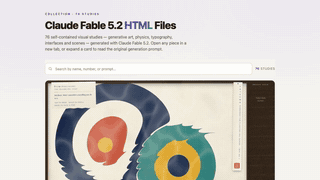 | **[76 个单文件 HTML 视觉作品集](https://miaai-lab.github.io/Claude-Fable-5.2-HTML-Files/)** 每个都附原始提示词 ♥ 2k | [@MiaAI_lab](https://x.com/MiaAI_lab) | [post](https://x.com/MiaAI_lab/status/2119930229661503893) |
| 6 | 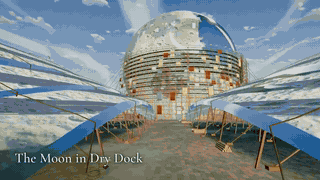 | **[Portals 无尽传送门世界](https://portals-endless-worlds.netlify.app/)** 2.5 万个 Agent 做出 450 多个代码 3D 世界，传送门相连自动漫游 ♥ 1.5k ↳ [源码](https://github.com/emollick/ai-portals) ↳ [文章](https://www.oneusefulthing.org/p/fable-52-and-jagged-agi) | [@emollick](https://x.com/emollick) | [post](https://x.com/emollick/status/2119918307457577163) |

---

## 🎮 Games · 22
可以直接打开开玩的游戏 — 从第一人称射击到整个可破坏的地球。

| # | Preview | Work | Creator | Post |
|---|---------|------|---------|------|
| 1 |  | **[Saltline 第一人称射击](https://claude.ai/artifact/BGY1SztrAYcJQHSsnHHGmp)** Anthropic 工程师；一次性提示、无人工反馈跑 8 小时，约 $550；模型、音效、贴图全部代码生成 ♥ 7.5k | [@felixrieseberg](https://x.com/felixrieseberg) | [post](https://x.com/felixrieseberg/status/2119925633564463609) |
| 2 | 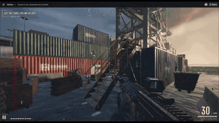 | **[Three Games 合集页（Saltline / 钟表匠之心 / Tidewright）](https://claude.ai/artifact/MXxb36zKgN261ckbGhmNin)** 页面署名 Felix Rieseberg，写明三款都是 Fable 5.2 无人工反馈的初稿；被转发最多的链接（视频来自转发者 @vineerpasam） ♥ 730 ↳ [钟表匠之心](https://claude.ai/artifact/6MjtQjf4ee1ZZjEpafaEpa) ↳ [Tidewright](https://claude.ai/artifact/JTgyEMn7sn1q2riWrMb7D4) | [@felixrieseberg](https://x.com/felixrieseberg) | [post](https://x.com/vineerpasam/status/2119955306096857145) |
| 3 |  | **[Mirror Earth 镜像地球](https://www.spawn.co/@mattshumer/earth?room=local)** 整个地球可去可破坏，天气等与真实地球实时同步 ♥ 2k | [@mattshumer_](https://x.com/mattshumer_) | [post](https://x.com/mattshumer_/status/2119877065701036047) |
| 4 | 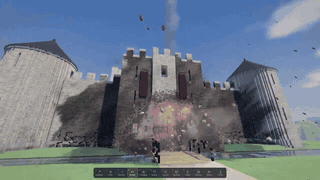 | **[体素引擎](https://www.spawn.co/@mattshumer/voxel-engine)** 一条提示词生成，要开声音 ♥ 668 | [@mattshumer_](https://x.com/mattshumer_) | [post](https://x.com/mattshumer_/status/2119870965106483384) |
| 5 |  | **[Hogwarts Royale（哈利·波特 × 堡垒之夜）](https://www.spawn.co/@mattshumer/hogwarts-royale)** 大逃杀玩法 ♥ 281 | [@mattshumer_](https://x.com/mattshumer_) | [post](https://x.com/mattshumer_/status/2119872098306810226) |
| 6 |  | **[Portals 无尽传送门世界](https://portals-endless-worlds.netlify.app/)** 2.5 万个 Agent 做出 450 多个代码 3D 世界，传送门相连自动漫游 ♥ 1.5k ↳ [源码](https://github.com/emollick/ai-portals) ↳ [文章](https://www.oneusefulthing.org/p/fable-52-and-jagged-agi) | [@emollick](https://x.com/emollick) | [post](https://x.com/emollick/status/2119918307457577163) |
| 7 |  | **[反向史酷比：吓跑多管闲事的孩子](https://i-would-have-gotten-away-with-it.netlify.app/)** 预告片的音乐音效也是它做的 ♥ 450 | [@emollick](https://x.com/emollick) | [post](https://x.com/emollick/status/2119876449494540554) |
| 8 |  | **[What the Water Keeps 梦境划船](https://what-the-water-keeps.vercel.app/)** 穿过 8 个梦境世界的划船游戏；原帖没放链接，链接来自转发者 @Bhavani_00007 / @meta_pavy ♥ 3.7k | [@kevin_t_ngo](https://x.com/kevin_t_ngo) | [post](https://x.com/kevin_t_ngo/status/2119868968307695818) |
| 9 |  | **[Turbo Tails 3D 卡丁车](https://turbo-tails.vercel.app)** 6 名车手、漂移、道具，单人和多人 ♥ 112 ↳ [对比视频](https://youtu.be/SsSKJA0EHD4) | [@petergyang](https://x.com/petergyang) | [post](https://x.com/petergyang/status/2119901658394358005) |
| 10 |  | **[童年地毯赛车](https://noclipepe.pages.dev/rug/)** 同题对比 GPT-6.2 Sol；作者写的是路由到的「Fable 5.5」 ♥ 404 | [@noclipepe](https://x.com/noclipepe) | [post](https://x.com/noclipepe/status/2119728047754547326) |
| 11 |  | **[Chrome 恐龙变兰博](https://noclipepe.pages.dev/dino)** 老 T-Rex 测试，对比 Opus / Gemini / GPT ♥ 97 | [@noclipepe](https://x.com/noclipepe) | [post](https://x.com/noclipepe/status/2119927838321328577) |
| 12 |  | **[Frontline 类 COD 死斗](https://spawn.co/@robot/frontline-warfare-deathmatch)** 浏览器里的使命召唤式射击 ♥ 86 | [@alightinastorm](https://x.com/alightinastorm) | [post](https://x.com/alightinastorm/status/2120020469487440210) |
| 13 |  | **[Feed the Backrooms：你当怪物](https://feed-backrooms.vercel.app)** 后室反转玩法，你负责抓人 ♥ 80 | [@LexnLin](https://x.com/LexnLin) | [post](https://x.com/LexnLin/status/2119966127149429093) |
| 14 |  | **[云端特技 3D](https://finderchangchang.github.io/cloud-stunt-3d/)** 30 分钟生成 ♥ 171 ↳ [优化版](https://finderchangchang.github.io/cloud-stunt-3d/golden/) | [@jev_chat](https://x.com/jev_chat) | [post](https://x.com/jev_chat/status/2120015641151426838) |
| 15 |  | **[Worm Rider 沙虫骑士](https://github.com/amirmushichge/worm-rider)** 开源；220KB、3400 行、10 条提示词，模型全部代码建 ♥ 170 | [@AmirMushich](https://x.com/AmirMushich) | [post](https://x.com/AmirMushich/status/2119937977426338283) |
| 16 | 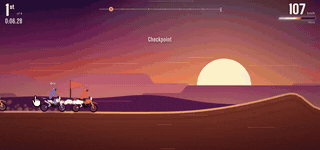 | **[Roost 3D 越野摩托](https://claude.ai/artifact/DLnFodkTwvawCNwurDmSZK?sk=5N6PtC07f1niB7h3I6clZQ)** 5 条提示词 15 分钟；3 条赛道、AI 对手、氮气 ♥ 2 | [@tejas3732](https://x.com/tejas3732) | [post](https://x.com/tejas3732/status/2120091513657139549) |
| 17 | 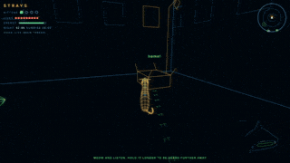 | **[流浪猫游戏](https://claude.ai/artifact/4nPXUKJjQWNsZEHVNmXXCt)** 救小猫、冲狗哈气、和老公猫对嚎，声音全部合成 ♥ 13 | [@aimikoda](https://x.com/aimikoda) | [post](https://x.com/aimikoda/status/2120120133712593118) |
| 18 |  | **[木头滚珠迷宫](https://blog.silencestar.com/posts/tilt-labyrinth/play/)** three.js 2000 行，它自己把单帧从 55ms 优化到 9ms ♥ 15 | [@mylifcc](https://x.com/mylifcc) | [post](https://x.com/mylifcc/status/2120054646282870910) |
| 19 | 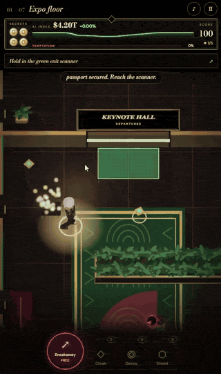 | **[Silicon Seduction](https://silicon-seduction.vercel.app/)** 逃出去别被诱惑 ♥ 12 | [@ZryMiller](https://x.com/ZryMiller) | [post](https://x.com/ZryMiller/status/2119918766691954691) |
| 20 | 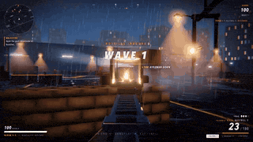 | **[Vippi 类 COD 射击](https://vippi.vercel.app/)** A COD-style shooter. The author's creepy-game benchmark is linked too. ♥ 1 ↳ [恐怖游戏测试](https://claude.ai/artifact/HSxhHE91J2jhLsB8WiTgUc) | [@Shrit1401](https://x.com/Shrit1401) | [post](https://x.com/Shrit1401/status/2120060593763926314) |
| 21 |  | **[格斗游戏（ElevenLabs 配音）](https://claude.ai/artifact/1QGGhB68jMCjjjeeKtKNUo)** Fable 5.2 + ElevenLabs MCP，桌面键盘玩 ♥ 2 | [@promodenstudio](https://x.com/promodenstudio) | [post](https://x.com/promodenstudio/status/2120085977079107788) |
| 22 |  | **[VOWLORN 纯代码暗黑 RPG](https://higgsfield.ai/@higgsfield.studio/blogs/fable-5-2-built-this-rpg-from-pure-code-here-s-every-step)** 配音也是代码生成，经 Higgsfield MCP 发布；链接是带试玩入口的博客页 ♥ 24 ↳ [骑龙游戏](https://higgsfield.ai/@higgsfield.studio/blogs/claude-fable-5-2-built-a-dragon-riding-game-play-it-free) ↳ [手绘变恐怖游戏](https://higgsfield.ai/@higgsfield.studio/blogs/one-drawing-fable-5-2-turned-it-into-a-horror-game) | [@higgsfield_ai](https://x.com/higgsfield_ai) | [post](https://x.com/higgsfield_ai/status/2119997122896601269) |

---

## 🌍 3D Worlds & Scenes · 12
可漫游的 3D 世界与实时渲染场景。

| # | Preview | Work | Creator | Post |
|---|---------|------|---------|------|
| 23 |  | **[Blender 房间里的「Claude App」网页](https://claude.ai/artifact/QGWUAjRrzRzZWGcQzSMLfa)** 一条提示词建整个房间并渲 4K；链接是笔记本屏幕上那个仿 Claude App 的网页 ♥ 5.2k | [@rileybrown](https://x.com/rileybrown) | [post](https://x.com/rileybrown/status/2119902109709537708) |
| 24 |  | **[印度班加罗尔 Indiranagar 1 平方公里](https://indiranagar-live.vercel.app)** 用他们的地图数据 + 一条提示词 ♥ 405 | [@anshu4321](https://x.com/anshu4321) | [post](https://x.com/anshu4321/status/2119938067758772403) |
| 25 |  | **[海盗船航行](https://tests.jazii.dev/)** 一次生成，1.5 小时、约 $34 ♥ 107 | [@notjazii](https://x.com/notjazii) | [post](https://x.com/notjazii/status/2119905661505122575) |
| 26 | 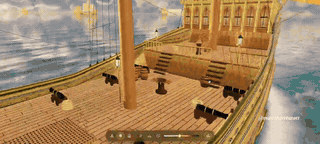 | **[3D 帆船](https://claude.ai/artifact/7ge282etTXSS4edGFTFa85)** 纯 Three.js，约 38 分钟 $17 ♥ 100 | [@marcthecreatorr](https://x.com/marcthecreatorr) | [post](https://x.com/marcthecreatorr/status/2119890973560054072) |
| 27 |  | **[瓶中体素世界](https://claude.ai/artifact/9EgZpErM17kH2a9Q3WXW6f)** 30 分钟 $12.81 ♥ 55 | [@vib3coded](https://x.com/vib3coded) | [post](https://x.com/vib3coded/status/2120104517282775514) |
| 28 |  | **[果冻虎鲸材质研究](https://claude.ai/artifact/2PBXuQAnWDS2NpiPXHNLfL)** 软体果冻虎鲸，Fable 对 Opus ♥ 102 ↳ [Opus 5.5 版](https://claude.ai/artifact/75KLotWzZQ5RR23BGLePb8) | [@vib3coded](https://x.com/vib3coded) | [post](https://x.com/vib3coded/status/2119951060752375827) |
| 29 | 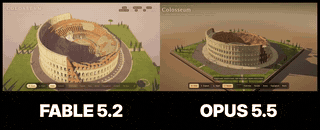 | **[体素罗马斗兽场](https://claude.ai/artifact/7nmzhxeamcunJbKVK32ptz)** 可以走进废墟内环 ♥ 19 ↳ [Opus 5.5 版](https://claude.ai/artifact/B7ZmVS7Yr3BUc99ZyGk2bX) | [@aGim_asf](https://x.com/aGim_asf) | [post](https://x.com/aGim_asf/status/2119918363799376270) |
| 30 |  | **[骑巨蜗牛的村庄](https://claude.ai/artifact/BCDCNHRTq3y9W4Px3xc4DN)** 手写 WebGL2，无库无素材，昼夜循环、约 5500 棵树 | [@L34342Lin](https://x.com/L34342Lin) | [post](https://x.com/L34342Lin/status/2120030246108066195) |
| 31 |  | **[五层木塔变身斗笠女侠](https://claude.ai/artifact/UqU4w7jSr6pzF2McsbyQjJ)** 3357 个构件，配乐代码现算，可拖拽、点击变身 | [@acupofai](https://x.com/acupofai) | [post](https://x.com/acupofai/status/2120119243043995748) |
| 32 |  | **[温哥华鸟瞰](https://vancouver.webly.site)** Three.js 重建城市 ♥ 39 | [@tokifyi](https://x.com/tokifyi) | [post](https://x.com/tokifyi/status/2120020272153764172) |
| 33 |  | **[单程太空旅行个人站](https://zondark.com)** 从地球滑到黑洞 ♥ 4 | [@ZondarkAI](https://x.com/ZondarkAI) | [post](https://x.com/ZondarkAI/status/2120106341423571097) |
| 34 |  | **[小行星带压力测试](https://claude.ai/artifact/FETrKoitcqxPQjbQvZd79C)** 约 2 万颗小行星环绕，不断加岩石直到设备掉到 30 帧 ♥ 4 | [@fadihares95](https://x.com/fadihares95) | [post](https://x.com/fadihares95/status/2119885634814857500) |

---

## 🧰 Web Pages & Tools · 15
实用或惊艳的网页应用与工具。

| # | Preview | Work | Creator | Post |
|---|---------|------|---------|------|
| 36 |  | **[Typed 打字机](https://typed.page/)** 能打字、计时、涂改液、自动更正的完整打字机 ♥ 167 | [@clairevo](https://x.com/clairevo) | [post](https://x.com/clairevo/status/2119905651359142132) |
| 37 |  | **[印度维生素该买哪些](https://itspsneha.com/supplements)** 读了 109 批检测报告做成的指南页 ♥ 433 | [@itspsneha](https://x.com/itspsneha) | [post](https://x.com/itspsneha/status/2120048494761451974) |
| 38 |  | **[Claudia Gallery](https://claudia.gallery)** 让它做「梦想中的视频」，9 小时两轮 ♥ 1.1k | [@anabology](https://x.com/anabology) | [post](https://x.com/anabology/status/2120010995309457643) |
| 39 |  | **[写作史（交互片）](https://v2.video/riley/the-history-of-writing/v1)** 一条提示词 ♥ 532 | [@rileybrown](https://x.com/rileybrown) | [post](https://x.com/rileybrown/status/2119946022767980985) |
| 40 |  | **[鼓组网站](https://claude.ai/artifact/9yQkezie4jY3oz2YDLFDiq)** 每次敲击海湾都有混响 ♥ 4 | [@BretKerr](https://x.com/BretKerr) | [post](https://x.com/BretKerr/status/2119995870854988177) |
| 41 |  | **[Dub Techno 曲子 + 可视化](https://claude.ai/artifact/Pk6rHPyRwfShT37kiU1sT6)** 一次生成 ♥ 4 | [@bartdecrem](https://x.com/bartdecrem) | [post](https://x.com/bartdecrem/status/2119926997422133417) |
| 42 | 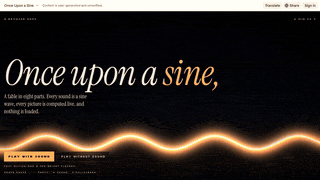 | **[Demoscene 浏览器演示](https://claude.ai/artifact/4aEy6FtUi7jrm9U7uYgp8K)** 按 demoscene 传统炫技 ♥ 1 | [@ndril](https://x.com/ndril) | [post](https://x.com/ndril/status/2119899340642894235) |
| 43 |  | **[112 种冥想图解](https://claude.ai/artifact/H8E7AonW2KFrzdRimaLeXb)** 给技术人看的可视化 | [@RishabJ108](https://x.com/RishabJ108) | [post](https://x.com/RishabJ108/status/2120042407484084558) |
| 44 |  | **[《罗摩衍那》男主的宝莱坞家谱](https://claude.ai/artifact/5ufHvxgvXTf5YgQeTR8TbG)** 血缘婚姻牵出 65 位明星 ♥ 2 | [@chhavsz](https://x.com/chhavsz) | [post](https://x.com/chhavsz/status/2119942973958078785) |
| 45 |  | **[独栋住宅设计提案书](https://claude.ai/artifact/TiymxxFXzMo7xhWUaecbzk)** 韩文，一天做完 ♥ 3 | [@pnumech](https://x.com/pnumech) | [post](https://x.com/pnumech/status/2120117665041940807) |
| 46 |  | **[JWT 落地页 20 种改版](https://jwt-designs-preview.noone-697.workers.dev/)** 一条简单提示词出 20 版 ♥ 7 | [@Tmeister](https://x.com/Tmeister) | [post](https://x.com/Tmeister/status/2119983842841018482) |
| 47 |  | **[Driftwood 落地页（Fable 对 Opus）](https://www.asumacodes.xyz/arena/driftwood)** 同提示词一次生成，两版都在线 ♥ 7 ↳ [番茄钟专注室](https://www.asumacodes.xyz/arena/focus-room) ↳ [找 Bug 对比](https://www.asumacodes.xyz/arena/bug-hunt) ↳ [系列首页](https://www.asumacodes.xyz/arena) | [@AsumaCodes](https://x.com/AsumaCodes) | [post](https://x.com/AsumaCodes/status/2120130668848177432) |
| 48 |  | **[Ribbon Hero 首屏](https://motionsites.ai/?prompt=vante-ribbon-hero)** Fable 5.2 + GPT Image 2.6 ♥ 65 | [@viktoroddy](https://x.com/viktoroddy) | [post](https://x.com/viktoroddy/status/2119985044542705916) |
| 49 |  | **[nikechan 个人站改版](https://nikechan.com/)** 日本开发者让它重做整站设计 ♥ 58 | [@tegnike](https://x.com/tegnike) | [post](https://x.com/tegnike/status/2120110145841578173) |
| 50 |  | **[76 个单文件 HTML 视觉作品集](https://miaai-lab.github.io/Claude-Fable-5.2-HTML-Files/)** 每个都附原始提示词 ♥ 2k | [@MiaAI_lab](https://x.com/MiaAI_lab) | [post](https://x.com/MiaAI_lab/status/2119930229661503893) |

---

## 🎬 Animation & Film (with source) · 8
附完整源码的动画与短片项目。

| # | Preview | Work | Creator | Post |
|---|---------|------|---------|------|
| 51 |  | **[One Sweep 78 秒动漫打斗](https://github.com/anstapnever/one-sweep)** 纯 Three.js 代码，6 组 Agent 并行；作者写的是「Fable 5.5」 ♥ 238 | [@anstapnever](https://x.com/anstapnever) | [post](https://x.com/anstapnever/status/2119772039037014524) |
| 52 |  | **[Blackout 79 秒动漫](https://github.com/anstapnever/blackout)** A 79-second anime short, all code. ♥ 96 | [@anstapnever](https://x.com/anstapnever) | [post](https://x.com/anstapnever/status/2119915123070644263) |
| 53 |  | **[Kagami 84 秒动漫](https://github.com/Florencvv/kagami)** 每一帧都是代码；作者写的是「Fable 5.5」 ♥ 36 | [@flxrnc](https://x.com/flxrnc) | [post](https://x.com/flxrnc/status/2119767052021903831) |
| 54 |  | **[Ryu 山化龙](https://github.com/seeconever/ryu)** 无生图无视频模型，5 组 Agent；作者写的是「Fable 5.5」 ♥ 36 | [@seeconvm](https://x.com/seeconvm) | [post](https://x.com/seeconvm/status/2119777169542938662) |
| 55 |  | **[哥斯拉之夜](https://github.com/ChetasLua/godzilla-nights)** 纯代码画图加动画 ♥ 159 | [@chetaslua](https://x.com/chetaslua) | [post](https://x.com/chetaslua/status/2119981510199808368) |
| 56 |  | **[圆珠笔微距 ASMR](https://github.com/crossps/ballpoint)** 开源证明不是视频模型生成 ♥ 239 | [@camperaigg](https://x.com/camperaigg) | [post](https://x.com/camperaigg/status/2119777467074580741) |
| 57 |  | **[机器手指走螺旋楼梯](https://github.com/skild-ai/steel-webgpu/pull/7)** Fable 5.2 + Steel 物理引擎 ♥ 52 | [@Luckyballa](https://x.com/Luckyballa) | [post](https://x.com/Luckyballa/status/2119915557663506720) |
| 58 |  | **[Kumiko 宣传片](https://usekumiko.app/)** 只给了音乐和网站，一次出片 ♥ 15 ↳ [插件](https://github.com/atuljha23/claude-motion-skill) | [@sudoaptaj](https://x.com/sudoaptaj) | [post](https://x.com/sudoaptaj/status/2119937909373460990) |

---

## 📺 Video-only Demos · 61
创作者只发了视频、没有公开链接。点击预览可看原帖视频。

| # | Preview | Work | Creator | Post |
|---|---------|------|---------|------|
| 61 | 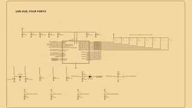 | ****官方：预发布测试期间的各领域项目合集**** What Fable 5.2 and Mythos 5.2 built across fields during testing. ♥ 30.8k | [@claudeai](https://x.com/claudeai) | [post](https://x.com/claudeai/status/2119899459761131615) |
| 62 | 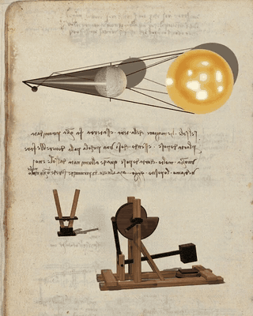 | ****达·芬奇 500 年前笔记本里的发明做成可交互**** A 500-year-old notebook PDF turned into inventions you can play with. ♥ 1.8k | [@alexalbert__](https://x.com/alexalbert__) | [post](https://x.com/alexalbert__/status/2119916954337349737) |
| 63 |  | ****Fishslop 测试，76 分钟 $42**** 76 minutes, ~$42. ♥ 2k | [@theo](https://x.com/theo) | [post](https://x.com/theo/status/2119926277801144695) |
| 64 |  | ****带传送门的竞技场 FPS，办公室里对战**** Playtested in the office. ♥ 1.6k | [@_sholtodouglas](https://x.com/_sholtodouglas) | [post](https://x.com/_sholtodouglas/status/2119935331499925557) |
| 65 |  | ****高速运镜 3D 场景，30 分钟 + Opus 子 Agent**** 30 minutes with a few Opus 5.5 subagents. ♥ 1.5k | [@LexnLin](https://x.com/LexnLin) | [post](https://x.com/LexnLin/status/2119880654858977333) |
| 66 | 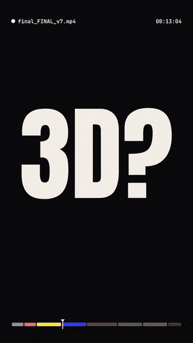 | ****给剪辑师的「抢饭碗」宣言视频**** ♥ 1.4k | [@ChrisGPT](https://x.com/ChrisGPT) | [post](https://x.com/ChrisGPT/status/2119998815856218494) |
| 67 | 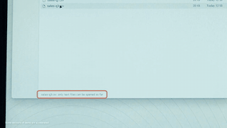 | ****官方演示：从空文件夹造操作系统（转述）**** Anthropic's demo of 1,000+ coordinated agents. ♥ 1.1k | [@chetaslua](https://x.com/chetaslua) | [post](https://x.com/chetaslua/status/2119870650722763052) |
| 68 | 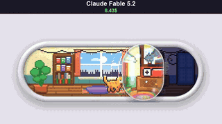 | ****上瘾的音量滑块，10 分钟 $8.43**** 10 minutes, $8.43. ♥ 1k | [@vib3coded](https://x.com/vib3coded) | [post](https://x.com/vib3coded/status/2119876781700505627) |
| 69 |  | ****玻璃泳池，Fable 对 Opus**** ♥ 812 | [@MrTacticalX](https://x.com/MrTacticalX) | [post](https://x.com/MrTacticalX/status/2119955647542542439) |
| 70 |  | ****一条提示词的 GTA 6**** ♥ 709 | [@ericmaskfr](https://x.com/ericmaskfr) | [post](https://x.com/ericmaskfr/status/2119910195325481026) |
| 71 | 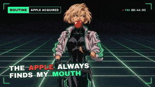 | ****一次生成合集**** ♥ 573 | [@WesRoth](https://x.com/WesRoth) | [post](https://x.com/WesRoth/status/2119953913160093817) |
| 72 | 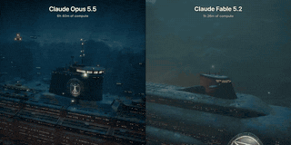 | ****Opus 对 Fable**** ♥ 464 | [@dom_scholz](https://x.com/dom_scholz) | [post](https://x.com/dom_scholz/status/2119933150025363661) |
| 73 |  | ****纯代码整部电影，配音画面全包**** Voices, graphics, everything. ♥ 400 | [@mattshumer_](https://x.com/mattshumer_) | [post](https://x.com/mattshumer_/status/2119900920347828670) |
| 74 | 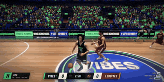 | ****AAA 级 three.js 篮球**** ♥ 355 | [@alightinastorm](https://x.com/alightinastorm) | [post](https://x.com/alightinastorm/status/2120010936584945922) |
| 75 | 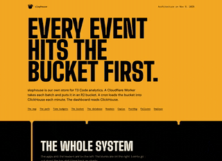 | ****数据管线写着写着做成的设计稿**** ♥ 327 | [@theo](https://x.com/theo) | [post](https://x.com/theo/status/2120104895646937409) |
| 76 | 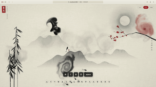 | ****打字生成墨水字形，实时流体 + 音效**** Type a character and it becomes live fluid ink, with sound. ♥ 298 | [@op7418](https://x.com/op7418) | [post](https://x.com/op7418/status/2120085300185833878) |
| 77 | 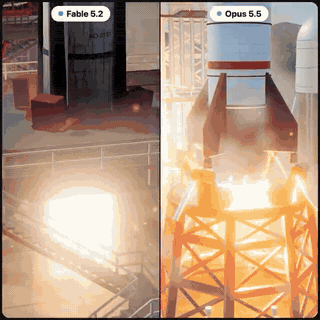 | ****火箭发射，Fable 对 Opus**** ♥ 295 | [@Bhavani_00007](https://x.com/Bhavani_00007) | [post](https://x.com/Bhavani_00007/status/2119902204320780676) |
| 78 |  | ****Fable 剪的关于 Fable 剪辑的视频**** ♥ 294 | [@rileybrown](https://x.com/rileybrown) | [post](https://x.com/rileybrown/status/2119973951027724385) |
| 79 | 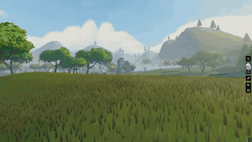 | ****一天做出 MMO 世界**** ♥ 275 | [@Izkimar](https://x.com/Izkimar) | [post](https://x.com/Izkimar/status/2119931740940640542) |
| 80 |  | ****热带岛屿写实 FPS，一条提示词**** One prompt. ♥ 273 | [@imantiai](https://x.com/imantiai) | [post](https://x.com/imantiai/status/2119979537320534135) |
| 81 |  | ****同提示词 5.1 对 5.2 的 App 改版**** ♥ 242 | [@RuslanKyrch](https://x.com/RuslanKyrch) | [post](https://x.com/RuslanKyrch/status/2119896220814762218) |
| 82 |  | ****Fable 对 Opus 同题**** ♥ 200 | [@notjazii](https://x.com/notjazii) | [post](https://x.com/notjazii/status/2119886035421442097) |
| 83 |  | ****粉笔画活过来**** ♥ 199 | [@dfeinition](https://x.com/dfeinition) | [post](https://x.com/dfeinition/status/2119881243990859818) |
| 85 |  | ****布料褶皱与光**** ♥ 186 | [@dfeinition](https://x.com/dfeinition) | [post](https://x.com/dfeinition/status/2119886262211625062) |
| 86 |  | ****Blender + Reaper 声音设计**** ♥ 182 | [@AmirMushich](https://x.com/AmirMushich) | [post](https://x.com/AmirMushich/status/2119903338078564844) |
| 87 |  | ****割草模拟器**** ♥ 178 | [@_MaxBlade](https://x.com/_MaxBlade) | [post](https://x.com/_MaxBlade/status/2119992020076814436) |
| 88 | 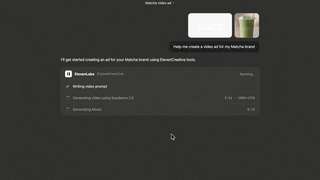 | ****Fable + ElevenLabs MCP 做广告**** ♥ 177 | [@ElevenCreative](https://x.com/ElevenCreative) | [post](https://x.com/ElevenCreative/status/2120025947709837525) |
| 89 |  | ****Blender 城堡，Fable 对 Opus**** ♥ 174 | [@Stefan_3D_AI](https://x.com/Stefan_3D_AI) | [post](https://x.com/Stefan_3D_AI/status/2120041169719894165) |
| 90 |  | ****Blender 鹈鹕骑自行车，4800 行 Python**** ~4,800 lines of Python, 444 frames. ♥ 171 | [@themianoo](https://x.com/themianoo) | [post](https://x.com/themianoo/status/2120042064666882266) |
| 91 |  | ****剑斗游戏**** ♥ 171 | [@EvanMilenko](https://x.com/EvanMilenko) | [post](https://x.com/EvanMilenko/status/2119969113762082931) |
| 92 |  | ****音乐 MV**** ♥ 162 | [@WesRoth](https://x.com/WesRoth) | [post](https://x.com/WesRoth/status/2119911161386934330) |
| 93 |  | ****Unreal Engine 5.9 MCP 跑 4 小时**** ♥ 142 | [@_MaxBlade](https://x.com/_MaxBlade) | [post](https://x.com/_MaxBlade/status/2120109725740159390) |
| 94 | 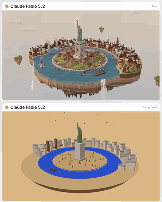 | ****漂浮在空中的 1886 年纽约**** ♥ 137 | [@semichenkko](https://x.com/semichenkko) | [post](https://x.com/semichenkko/status/2119960596951236675) |
| 95 |  | ****three.js 莫妮卡的公寓**** ♥ 135 | [@chetaslua](https://x.com/chetaslua) | [post](https://x.com/chetaslua/status/2120111159726727321) |
| 96 | 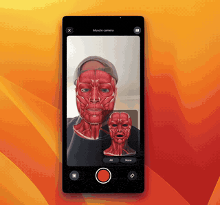 | ****SwiftUI 换瞳色 App**** ♥ 134 | [@solotechdev](https://x.com/solotechdev) | [post](https://x.com/solotechdev/status/2120071690482794603) |
| 97 |  | ****交响乐**** ♥ 130 | [@RJasonHA](https://x.com/RJasonHA) | [post](https://x.com/RJasonHA/status/2120007540713099768) |
| 98 |  | ****能在公寓里真做出来的机器人**** ♥ 128 | [@mattshumer_](https://x.com/mattshumer_) | [post](https://x.com/mattshumer_/status/2119889518564147409) |
| 99 | 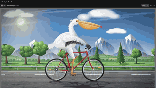 | ****鹈鹕骑自行车经典测试**** ♥ 122 | [@abhinavflac](https://x.com/abhinavflac) | [post](https://x.com/abhinavflac/status/2119884257145581980) |
| 100 | 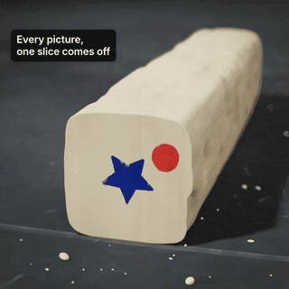 | ****黏土动画**** ♥ 116 | [@dfeinition](https://x.com/dfeinition) | [post](https://x.com/dfeinition/status/2119892208937517201) |
| 102 |  | ****4 台游戏机械概念，VFX 物理**** VFX, mechanics and physics tests. ♥ 114 | [@techartist_](https://x.com/techartist_) | [post](https://x.com/techartist_/status/2119946891106394518) |
| 103 | 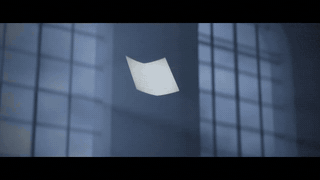 | ****深夜图书馆两万四千页飞舞**** 24,000 pages take flight. ♥ 105 | [@lemomo_ai](https://x.com/lemomo_ai) | [post](https://x.com/lemomo_ai/status/2120118194409193682) |
| 104 |  | ****巴赫风格赋格（LilyPond）**** Written in LilyPond. ♥ 90 | [@aug5thmusic](https://x.com/aug5thmusic) | [post](https://x.com/aug5thmusic/status/2119907891419480107) |
| 105 | 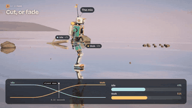 | ****动作融合讲解机器人**** ♥ 86 | [@dfeinition](https://x.com/dfeinition) | [post](https://x.com/dfeinition/status/2119870838606381391) |
| 106 | 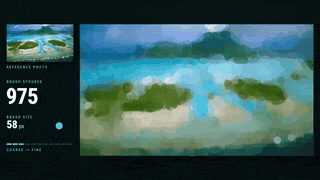 | ****用绘图工具复刻波拉波拉照片**** ♥ 79 | [@AlchainHust](https://x.com/AlchainHust) | [post](https://x.com/AlchainHust/status/2120065556003102731) |
| 107 | 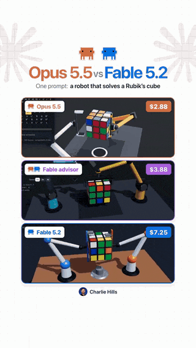 | ****解魔方机器人，Fable 对 Opus**** ♥ 78 | [@charliejhills](https://x.com/charliejhills) | [post](https://x.com/charliejhills/status/2120105823737397644) |
| 108 | 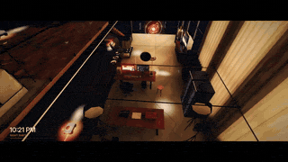 | ****照 Riley 做自己的工作室**** ♥ 68 | [@rpnickson](https://x.com/rpnickson) | [post](https://x.com/rpnickson/status/2119969928304357507) |
| 109 |  | ****一句话给 BlewUp 做发布片**** ♥ 68 | [@wangray](https://x.com/wangray) | [post](https://x.com/wangray/status/2120040640423850168) |
| 110 |  | ****儿童英语启蒙动画**** ♥ 63 | [@linxiaobei888](https://x.com/linxiaobei888) | [post](https://x.com/linxiaobei888/status/2119978892861829227) |
| 111 | 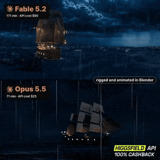 | ****Blender 海蛇缠船**** ♥ 59 | [@Stefan_3D_AI](https://x.com/Stefan_3D_AI) | [post](https://x.com/Stefan_3D_AI/status/2120039417981333599) |
| 112 |  | ****四模型同题文字特效**** ♥ 55 | [@leppppp1](https://x.com/leppppp1) | [post](https://x.com/leppppp1/status/2119960122713899015) |
| 113 |  | ****420 个蛋白亚基组装病毒衣壳**** One prompt, one HTML file. ♥ 52 | [@TekonBurns](https://x.com/TekonBurns) | [post](https://x.com/TekonBurns/status/2119871565311660260) |
| 114 | 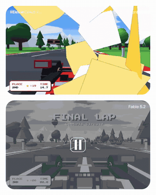 | ****有无 ElevenLabs 音效的游戏对比**** ♥ 47 | [@ElevenCreative](https://x.com/ElevenCreative) | [post](https://x.com/ElevenCreative/status/2119963230403776554) |
| 115 |  | ****开声音看的效果**** ♥ 42 | [@guanmo_ai](https://x.com/guanmo_ai) | [post](https://x.com/guanmo_ai/status/2119989925038985382) |
| 116 |  | ****狮子从地毯里爬出，Fable 对 Gemini**** ♥ 42 | [@kinderlayer](https://x.com/kinderlayer) | [post](https://x.com/kinderlayer/status/2120112222227648957) |
| 117 |  | ****$36 的权游级巨龙**** ♥ 42 | [@Lummox_eth](https://x.com/Lummox_eth) | [post](https://x.com/Lummox_eth/status/2120093679243194793) |
| 118 |  | ****手机上跑的 Artifact 游戏**** ♥ 40 | [@ChrisGPT](https://x.com/ChrisGPT) | [post](https://x.com/ChrisGPT/status/2119989626568126509) |
| 119 |  | ****发布当天做的片子（附提示词 PDF）**** ♥ 40 | [@flxrnc](https://x.com/flxrnc) | [post](https://x.com/flxrnc/status/2119961301791174720) |
| 120 |  | ****Blender 复刻特斯拉 Roadster 翻板**** ♥ 38 | [@Stefan_3D_AI](https://x.com/Stefan_3D_AI) | [post](https://x.com/Stefan_3D_AI/status/2120101582444597446) |
| 121 |  | ****浮岛上建造中的埃菲尔铁塔**** ♥ 32 | [@ItsmeAjayKV](https://x.com/ItsmeAjayKV) | [post](https://x.com/ItsmeAjayKV/status/2119896772713849174) |
| 122 |  | ****雪花球，Fable 对 Opus**** ♥ 30 | [@MrTacticalX](https://x.com/MrTacticalX) | [post](https://x.com/MrTacticalX/status/2119949557664735583) |
| 123 |  | ****代码搭的唐人街**** ♥ 35 | [@RJasonHA](https://x.com/RJasonHA) | [post](https://x.com/RJasonHA/status/2120075740222005569) |

---

## 🔗 相关清单
- [awesome-fable5-2-videos](https://github.com/yihui-dev/awesome-fable5-2-videos) — 专注于视频和背后提示词的姐妹清单。

## 🧭 这份清单是怎么做的
- 全部 118 个作品来自发布后 48 小时内的 X 帖子。
- 每个作品链接都在浏览器中实际打开确认可加载；每个视频都完整看过或抽查过。
- 动图预览（几秒、静音、低清）取自创作者自己的演示视频或在线站点。
- 媒体报道、"现已在 X 上线"广告、工具仓库和纯转发已剔除。署名一律归原作者；仅当创作者本人未发链接时才注明转发者。

## 🤝 投稿
发现有漏掉的？开一个 [issue](../../issues/new) 或 PR，附上作品链接和原帖。链接必须能直接打开，作品必须是用 Fable 5.2 做的。详见 [CONTRIBUTING.md](CONTRIBUTING.md)。

条目统一加到 [`data/works.json`](data/works.json)，两份 README 都由它自动生成。

## ⚖️ 许可与声明
所有作品版权归创作者本人。本仓库只做索引，仅保留几秒的低清动图预览，不含完整作品或视频；完整视频请移步原帖。创作者可通过 issue 要求撤下预览或条目。与 Anthropic 无关。

本仓库内容遵循 [CC0-1.0](LICENSE) 发布。

策展人 <strong>Helium</strong> · Fork 自 <a href="https://github.com/fengyiqicoder/awesome-fable-5.2">awesome-fable-5.2</a>

